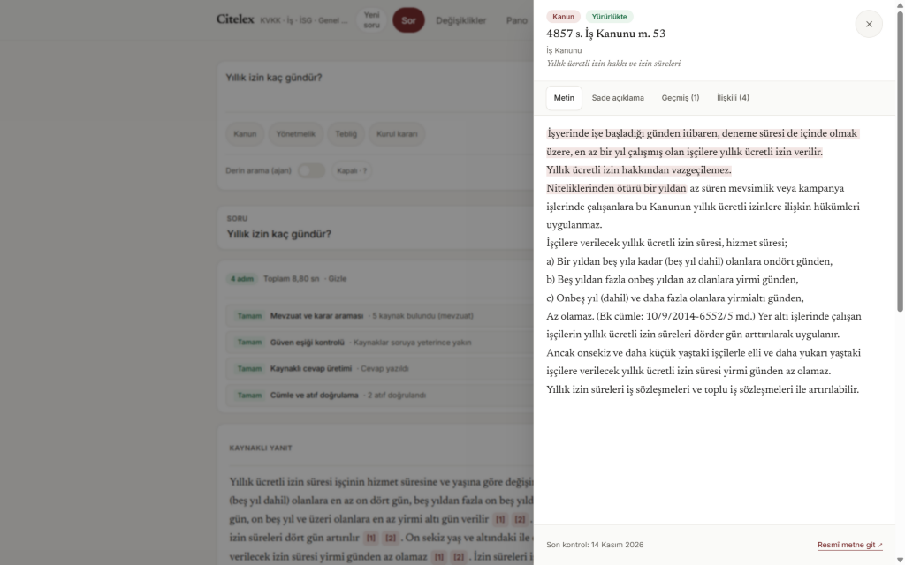
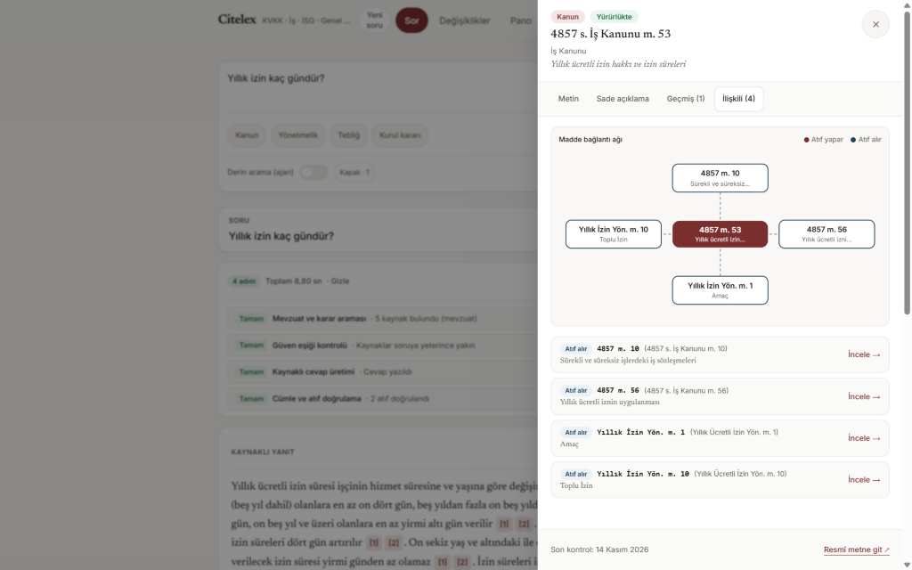
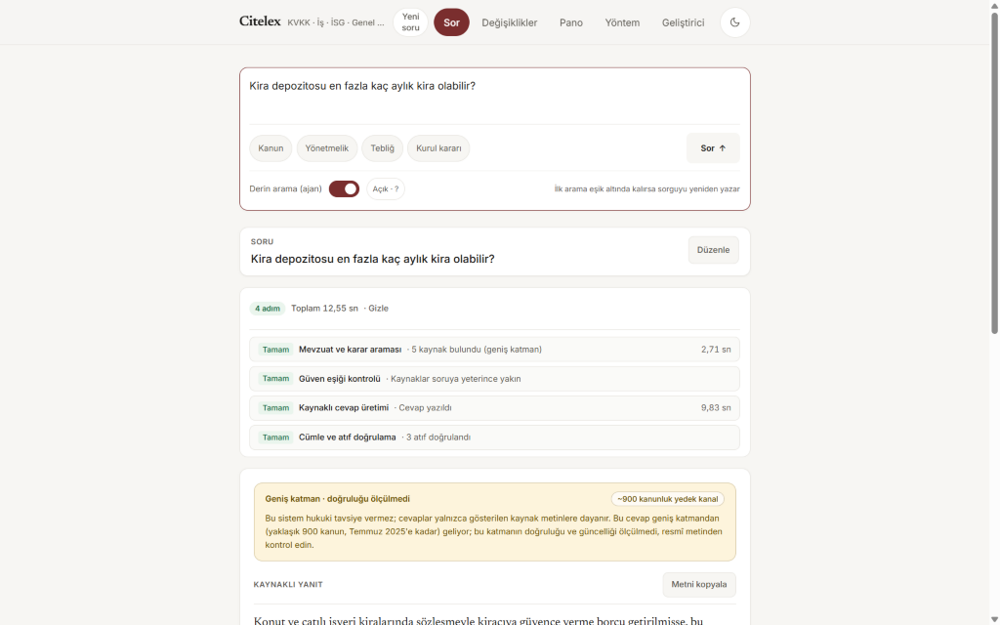
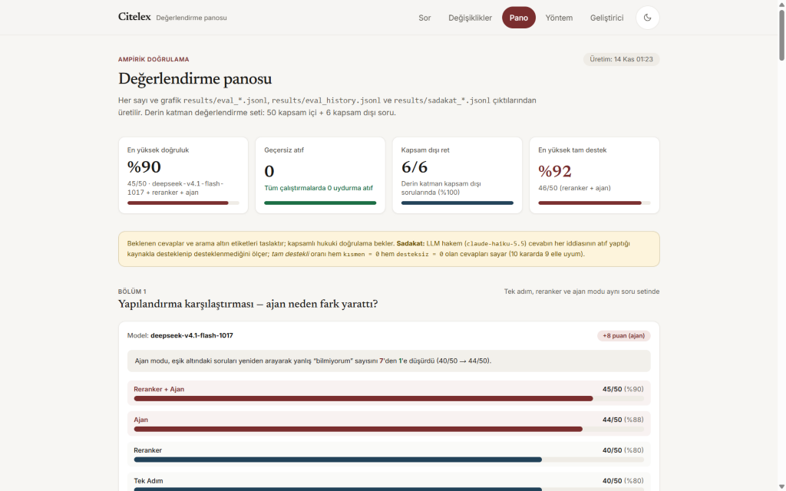
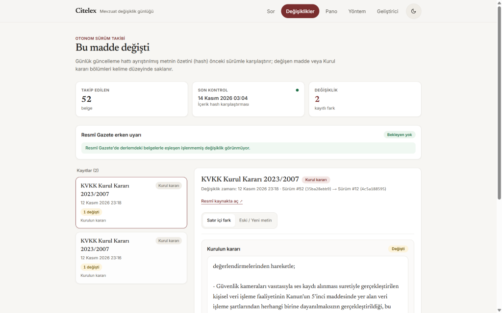

[](https://github.com/<OWNER>/<REPO>/actions/workflows/ci.yml)

# Citelex — Türk Mevzuatı için Kaynak Gösteren RAG

**Citelex**, Türk iş hukuku ve kişisel verilerin korunması alanındaki derin katman mevzuatını (`12` mevzuat belgesi ve `40` seçili KVKK Kurul kararı; toplam `52` belge) ve gerektiğinde `895` kanunluk (`44.854` parça) geniş katmanı madde/fıkra düzeyinde dizinleyip her iddiayı resmi kaynağa dayandırarak yanıtlayan, kaynak değiştikçe kendini güncelleyebilen ve kanıt yetersiz kaldığında `"bilmiyorum"` diyebilen bir RAG sistemidir.

> **Uyarı:** Bu sistem hukuki tavsiye vermez; yalnızca dizinlenen mevzuat ve kurul kararları üzerinden kaynak göstererek bilgi sunar.

## Mimari


## Ekranlar

**Kaynaklı yanıt ve madde paneli** — `[n]` atıflarına tıklandığında ilgili kanun/yönetmelik/karar metni, değişiklik geçmişi ve ilişkili maddeler ağı yan panelde açılır:





**Geniş katman uyarısı ve kapsam dışı reddi** — Derin katman eşiği geçemediğinde ~900 kanunluk geniş katman devreye girer ve doğrulanmamış katman uyarısı gösterilir; derlemle ilgisiz sorular reddedilir:



**Değerlendirme panosu ve değişiklik takibi** — Model/yapılandırma karşılaştırması (`/pano`) ile eski–yeni sürüm kelime farkı (`/degisiklikler`):





Diğer ekranlar: [Kapsam dışı ret](docs/ekran/03_bilmiyorum.png) · [Mobil görünüm](docs/ekran/06_mobil.png) · [Jaeger / OpenTelemetry izi](docs/ekran/07_jaeger.png)

## Sonuçlar

### Model ve yapılandırma karşılaştırması (`56` soru: `50` kapsam içi, `6` kapsam dışı)

| Model (yapılandırma) | Doğru | Tam destekli sadakat | İddia desteği | Yanlış "bilmiyorum" | Kapsam dışı ret | Medyan süre |
|---|---:|---:|---:|---:|---:|---:|
| `openrouter:deepseek/deepseek-v4.1-flash-1017` (ajan + reranker) | 45/50 (%90) | 46/50 (%92) | 181/185 (%98) | 0/50 (%0) | 6/6 (%100) | 3,98 sn |
| `openrouter:deepseek/deepseek-v4.1-flash-1017` (ajan) | 44/50 (%88) | 46/49 (%94) | 177/182 (%97) | 1/50 (%2) | 6/6 (%100) | 2,42 sn |
| `openrouter:deepseek/deepseek-v4.1-flash-1017` (reranker) | 40/50 (%80) | — | — | 7/50 (%14) | 6/6 (%100) | 3,66 sn |
| `openrouter:deepseek/deepseek-v4.1-flash-1017` (tek adım) | 40/50 (%80) | 41/43 (%95) | 161/163 (%99) | 7/50 (%14) | 6/6 (%100) | 1,90 sn |
| `openrouter:qwen/qwen3.7-flash` (tek adım) | 39/50 (%78) | 26/42 (%62) | 145/162 (%90) | 8/50 (%16) | 6/6 (%100) | 2,39 sn |
| `openrouter:nvidia/nemotron-3-ultra-550b-a55b:free` (tek adım) | 39/50 (%78) | 35/42 (%83) | 86/93 (%92) | 8/50 (%16) | 6/6 (%100) | 2,43 sn |
| `ollama:qwen2.5:7b` (tek adım) | 33/50 (%66) | — | — | 12/50 (%24) | 6/6 (%100) | 2,86 sn |

*Kaynak: `results/eval_history.jsonl`, `results/eval_*.md`, `results/sadakat_*__hakem_openrouter_anthropic_claude_haiku_5.5.jsonl` ve `KARARLAR.md`. Tüm çalıştırmalarda geçersiz atıf `0`'dır.*

### Varsayılan çalışma ve OpenRouter devre kesici

- **Yerel (GPU) vs yayın (CPU) varsayılanı:** En yüksek ölçüm **ajan + reranker** (`45/50`, `KARARLAR.md`) olduğundan yerel GPU ortamında ikisi birlikte varsayılan açıktır. Ancak `bge-reranker-v2-m3` 16 çekirdek CPU'da sorgu başına `43,0–118,9 sn` (`43,0 / 118,9 / 42,9 sn`, `KARARLAR.md`) sürdüğü için `docker-compose.yml` / CPU yayında `CITELEX_RERANK=0` ile kapalı tutulur ve yalnızca **ajan modu** (`44/50`, medyan `2,42 sn`) varsayılan çalışır.
- **OpenRouter zinciri ve devre kesici:** `OPENROUTER_MODELS` içindeki modeller sırayla denenir (ör. ücretsiz kota dolunca ücretli yedeğe geçer). Günlük kota `429` hatasında ilgili model `1 saat`, diğer `429`'larda `60 sn` devre dışı bırakılır (`KARARLAR.md`).

### Reranker geri getirme ölçümü ve arama deneyleri

| Yöntem (geri getirme) | Alt küme | R@1 | R@3 | R@5 | MRR |
|---|---|---:|---:|---:|---:|
| Hibrit (bge-m3 + BM25, RRF k=60) | Mevzuat (`n=51`) | 43/51 | 48/51 | 48/51 | 0,898 |
| Hibrit + reranker (`30` aday) | Mevzuat (`n=51`) | 48/51 | 49/51 | 50/51 | 0,957 |
| Hibrit | KVKK kararı (`n=12`) | 11/12 | 12/12 | 12/12 | 0,958 |
| Hibrit + reranker (`30` aday) | KVKK kararı (`n=12`) | 12/12 | 12/12 | 12/12 | 1,000 |

*Kaynak: `results/rerank_compare.md` (GPU fp16 medyan `0,74 sn/sorgu`). Parçalama × yöntem ve BM25 vs `bge-m3` sparse karşılaştırmaları `results/compare_retrieval.md` dosyasındadır.*

### CI arama kapısı temel değerleri

- **BM25 (bellek içi fixture):** mevzuat `48/51`, KVKK kararı `12/12`
- **Qdrant (hibrit):** mevzuat `48/51`, KVKK kararı `12/12`

*Kaynak: `eval/gate_baseline.json`.*

## Değerlendirme Yöntemi ve Sınırlar

- **Taslak soru seti ve içerik ölçütü:** `56` soruluk sette beklenen cevaplar taslaktır (hukuki doğrulama bekler); `icerik` ölçütü anahtar kelime eşleşmesine dayanır (`KARARLAR.md`).
- **Hakem kararlılığı:** LLM hakem (`anthropic/claude-haiku-5.5`) üzerindeki `10` kararlık elle kontrolde `9` uyum görülmüştür; asıl sadakat ölçütü tüm iddiaların desteklendiği `tam_destekli` oranıdır (`KARARLAR.md`).
- **Eşik tercihi:** Kalibrasyon `30` soruluk ayrı sette yapılmış; `0,574` yerine `0,637` eşiği seçilmiştir (`KARARLAR.md`, `results/calibration.md`). Tutucu eşik kısa/genel kapsam içi soruları reddedebilir; ajan modu bu oranı `7/50`'den `1/50`'ye düşürür.
- **Geniş katman (`895` kanun, `44.854` parça):** Yalnızca derin katman `0,637` eşiğini geçemezse **veya** geniş katman dense top-1 puanı derin katmanı `0,05`'ten fazla (`GENIS_FARK=0,05`) geçerse `citelex_genis` (`32.925` birim, `44.854` parça; Qdrant diskte `323 MB`, derin katman `17 MB` — `KARARLAR.md`) seçilir (`CITELEX_GENIS=0` kapatır) ve yanıtlar `"Geniş katman · doğruluğu ölçülmedi"` rozetiyle döner. `δ=0,05`, eval setlerinden bağımsız `eval/calibration.jsonl` (`18` kapsam içi soru) üzerindeki en büyük geniş üstünlüğü (`+0,021`, `c11`) baz alınarak yaklaşık `2` kat güvenlik payıyla seçilmiştir (`KARARLAR.md`). Açık eval'de (`56` soru) kapsam içi değişmemiş (`45/50`) ve derin eval yönlendirmesi değişmemiştir; kapsam dışı ret `d03` (`7036` s. Kanun m.3) nedeniyle `6/6 -> 5/6`, medyan süre `3,98 -> 5,47 sn` olmuştur (`KARARLAR.md`). Taslak geniş katman setinde (`eval/genis_sorular.jsonl`: `15` kapsam içi + `3` kapsam dışı, `results/genis_check.md`) doğrudan geniş arama `R@1 10/15`, `R@5 14/15`, üretim yolu yönlendirme `14/15`, beklenen madde bağlamda `13/15`, kapsam dışı eşikte ret `3/3` ölçülmüştür. **Kalan sınır ve not:** `g02` (anlaşmalı boşanma) `0,629` skoruyla eşiğin hemen altında kalıp reddedilir; `g08` (`TCK m.141`) ilk `5`'te bulunamamıştır (`results/genis_check.md`). `g13` (devlet memuru analık izni) bu fark kuralını bulduran örnek olduğu için geniş taslak seti bu değişiklik açısından bağımsız değildir (`KARARLAR.md`).

## Kurulum

### 1. Ortam ve bağımlılıklar

```bash
conda activate citelex
# veya: pip install -r requirements.txt
```

`.env` dosyasını `.env.example` şablonundan oluşturun (değerleri örnekten kendi anahtarlarınızla doldurun):

- **Model / arama:** `GEMINI_API_KEY`, `OPENROUTER_API_KEY`, `OPENROUTER_MODELS`, `OLLAMA_HOST`, `CITELEX_LLM`, `QDRANT_URL`
- **Hız sınırı / CORS:** `CITELEX_RATE_DK`, `CITELEX_RATE_GUN`, `CITELEX_GUNLUK_TOPLAM`, `CITELEX_TRUST_PROXY`, `CITELEX_CORS`

### 2. Altyapı, veri hazırlama ve indeksleme

```bash
docker compose up -d qdrant
python -m src.ingest.parse
python -m src.ingest.chunk --mode hibrit --max-chars 1500
python -m src.ingest.parse_karar
python -m src.index.build --mode hibrit --recreate
python -m src.update.run --init
```

### 3. API, Web arayüzü ve izlenebilirlik

`web/src` statik çıktı üretir ve arayüzde sohbet dışında **`/pano`** (değerlendirme panosu), **`/degisiklikler`** (madde/bölüm kelime farkı) ve **`/yontem`** (2 dakikalık mimari/ölçüm özeti) sayfalarını sunar:

```bash
npm --prefix web run build        # web/out/ üretir; Compose api'si /app/web/out üzerinden sunar
docker compose up -d api          # http://127.0.0.1:8000/
# geliştirme modu: npm --prefix web run dev
# Jaeger izleri (http://127.0.0.1:16686): docker compose --profile izleme up -d
```

### 4. Masaüstü (Windows) ve Mobil (Android) istemci + MCP

- **Tauri 2 ince istemci (`desktop/`):** Aynı `web/out` arayüzünü paketler (Windows EXE `8,7 MB`, MSI `3,0 MB`, NSIS `2,0 MB`, Android arm64 APK `10,7 MB` — `KARARLAR.md`). Kurulum ve imza adımları için bkz. [desktop/README.md](desktop/README.md).
- **MCP sunucusu (`src/mcp_server.py`):** `mcp` stdio üzerinden `mevzuat_ara` ve `madde_getir` araçlarını sunar (`claude_desktop_config.json` içinde `"command": "python", "args": ["-m", "src.mcp_server"]`).

## Proje Yapısı

```text
citelex/
├── src/
│   ├── api/            # FastAPI + SSE, hız sınırı, /degisiklikler, /kaynak, statik web sunumu
│   ├── ingest/         # PDF/HTML/HF ayrıştırma ve hibrit madde/fıkra/ek parçalama
│   ├── index/          # bge-m3 dense + Türkçe BM25 sparse Qdrant indeksi (derin + geniş)
│   ├── retrieve/       # İki kanallı arama, eşik kapısı, bge-reranker-v2-m3, geniş katman
│   ├── generate/       # OpenRouter zinciri + devre kesici, atıf doğrulama, LangGraph ajan
│   ├── update/         # Sürüm deposu (SQLite), kelime/madde farkı, erken uyarı
│   └── mcp_server.py   # MCP sunucusu (mevzuat_ara, madde_getir)
├── eval/               # Kalibrasyon, değerlendirme koşucusu, hakem, CI BM25 kapısı
├── scripts/            # Yardımcı analiz ve pano_veri.py betikleri
├── results/            # Eval, sadakat, rerank ve arama deneyi çıktıları (.jsonl / .md)
├── web/                # Next.js statik arayüz (sohbet, /yontem, /pano, /degisiklikler)
├── desktop/            # Tauri 2 masaüstü (EXE) ve mobil (Android APK) kabuğu
└── docs/               # Mimari diyagram (mimari.svg)
```

## Neden Böyle?

- **İki kanallı arama:** Mevzuat (`5` aday) ve KVKK kararları (en fazla `3` karardan `2`'şer parça) ayrı aranır; tek havuz kısa karar parçalarını öne çıkarıp mevzuat başarısını `9/9`'dan `8/9`'a düşürmüştür (`KARARLAR.md`).
- **Hibrit parça boyu:** Madde `<= 1500` karakterse tek parça, büyükse fıkra bazında bölünür; uzun bent listeleri (`> 3000` karakter) gruplanır (`KARARLAR.md`).
- **Eşik kalibrasyonu ayrı sette:** Eşik (`0,637`) `56` soruluk testten ayrı `30` soruluk `eval/calibration.jsonl` setinde seçildi; veri sızıntısı önlenir (`KARARLAR.md`).
- **Fark JSON'unun önceden hesaplanması:** `src/update/diff.py` değişiklik anında kelime farkını `data/store/farklar/<fark_id>.json` olarak yazar; canlıda ham sürüm dosyası tutulmaz (`KARARLAR.md`).
- **Çekirdeği LangChain'e taşımama:** Hazır hibrit + RRF + atıf doğrulama hattı gerileme riski yaratmamak için sade bırakıldı; LangGraph yalnızca ajan modunda kullanılır (`KARARLAR.md`).
- **OpenTelemetry + Jaeger seçimi:** Langfuse harici hesap veya ağır yan servisler gerektirdiğinden satıcı bağımsız OTel + `logs/izler.jsonl` seçildi (`KARARLAR.md`).
